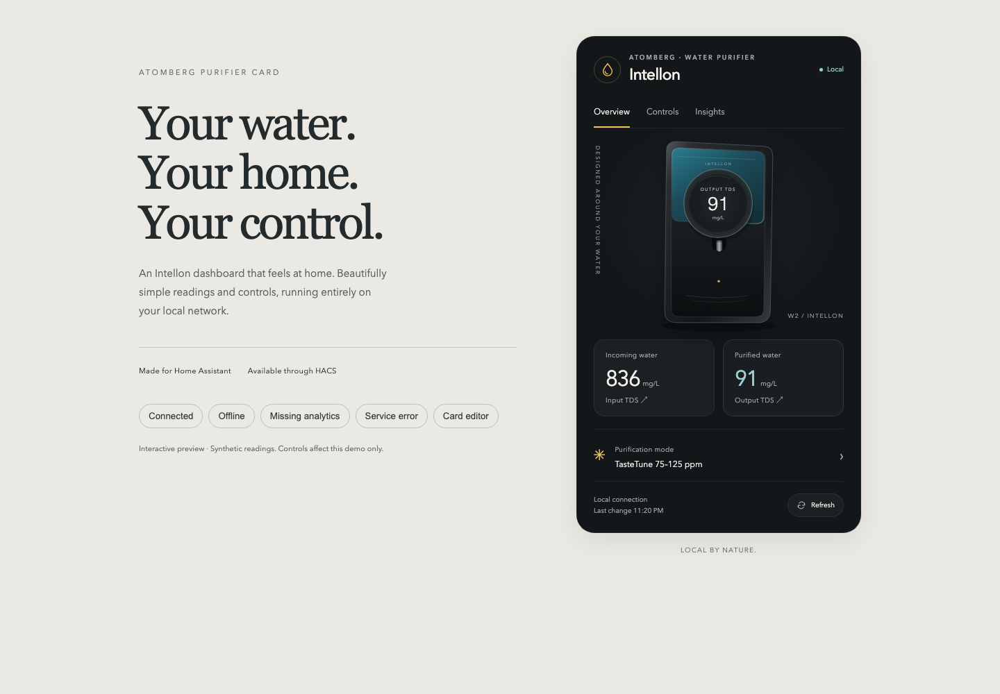
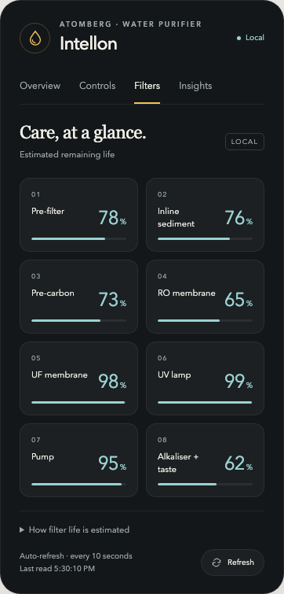

# Atomberg Water Purifier Local

<picture>
  <source media="(prefers-color-scheme: dark)" srcset="custom_components/atomberg_purifier_local/brand/dark_logo@2x.png">
  
</picture>

Control an Atomberg Intellon water purifier from Home Assistant over your home network. No Atomberg account, API key, subscription or cloud connection is used by this integration.

The purifier must already be connected to your Wi-Fi. First-time Wi-Fi setup is still done with the Atomberg app.

## What you get

- Purification mode: RO + UV, Adaptive, three TasteTune ranges and Vacay.
- Fallback purification mode and input TDS threshold.
- Display sleep and a daily sleep schedule, including start and end times.
- Input and output TDS readings, in mg/L, updated every 10 seconds.
- A **Refresh readings** button to request the device's latest readings immediately.
- A connection sensor showing your local connection and the last successful read time.
- Estimated remaining life for all eight filters and components, using the app’s capacity formulas.
- **Beta analytics:** lifetime water, estimated water saved, and purifier runtime. These match the W2 app; validation through a complete refill cycle is still pending.
- A bundled [dashboard card](#dashboard-card) with every reading and control, registered automatically.

Changes are confirmed by reading the setting back from the purifier. The integration does not assume a command succeeded just because it was sent.

**Tested hardware:** Intellon, local model identifier W2, reported firmware `74`. Other purifier models and firmware versions have not been verified. Atomberg fans use a different integration.

Filter-life estimates assume the original filters, UV lamp and pump. Past replacements and the app’s flow-based adjustments are not included; see [filter-life details](docs/filter-life.md). Fault explanations have not been mapped reliably. The app's **Skip Flow Check** fault workaround is also not mapped or exposed. The app's cloud history and firmware-update features are outside this integration.

## 1. Install with HACS

You need Home Assistant with [HACS](https://www.hacs.dev/) installed.

1. Open **HACS** in Home Assistant.
2. Search for **Atomberg Water Purifier Local**, open it, and click **Download**.
3. **Restart Home Assistant.**

Future updates appear in Home Assistant's update list.

**Added it earlier as a custom repository?** Nothing to change; updates keep working.

## 2. Add your purifier

1. Open **Settings → Devices & services → Add integration**.
2. Search for **Atomberg Water Purifier Local**.
3. Choose the purifier it finds. If it finds nothing, enter the purifier's IP address from your router's device list.
4. Setup checks the local connection before it finishes. Open the new device to see its controls and readings.

You do not need to edit YAML or enter an Atomberg password.

Home Assistant 2026.3 or newer displays the bundled Atomberg logo locally. See [brand image credits](docs/branding.md).

**Installing without HACS?** Download the source code of the [latest release](https://github.com/dtechterminal/ha-atomberg-water-purifier-local/releases/latest) and copy its `custom_components/atomberg_purifier_local` folder into your Home Assistant `config/custom_components/` folder. Restart Home Assistant, then follow step 2 above.

## 3. Keep it working without the internet

1. In Home Assistant, turn **Display sleep** on, check the purifier's display, then restore the setting.
2. Open your router's app or website. Block **internet/WAN access for the purifier only**. Keep its Wi-Fi and local access to Home Assistant enabled.
3. Repeat the display test. Make sure the TDS readings keep updating too.
4. Reserve the purifier's IP address in your router so it does not change later.

Some routers call their block option “Pause device” and block the whole network connection. Use an internet-only rule instead. If you use IPv6, the rule should cover that too.

The Atomberg app's cloud features and online updates may stop working while internet access is blocked. Home Assistant controls use the local connection.

## Dashboard card

The integration includes an app-style dashboard card with the purifier illustration, TDS readings, all local controls, a Filters page and beta lifetime analytics. Nothing extra to install: the integration serves the card itself and adds it to your dashboard resources.

1. Open your dashboard and choose **Edit dashboard → Add card**.
2. Search for **Atomberg Purifier**. With one purifier, it finds the device automatically. With several, choose one in the card editor.
3. Give it a title if you like, then **Save**.



The visual editor is the easiest route. YAML also works:

```yaml
type: custom:atomberg-purifier-card
title: Kitchen water
show_analytics: true
```

For multiple purifiers, add `entity:` using that purifier's **Input TDS** entity. The other entities are found automatically.

**Can't see the card?** Reload the browser. Under **Settings → Dashboards → ⋮ → Resources**, check that `/atomberg_purifier_local/atomberg-purifier-card.js` is listed as a JavaScript module. If your dashboard resources are managed in YAML, add that URL yourself.

**Used the separate Atomberg Purifier Card before?** Remove it from HACS. The bundled card replaces it and keeps the same card type, so your dashboards keep working.



## Useful tips

- **Filter life** updates automatically. These are remaining-capacity estimates, not measurements of water safety. If a component has been replaced, its estimate will be inaccurate because replacement records are not imported from the app.
- **Sleep times** use the time zone configured in Home Assistant. Enable **Sleep schedule** before changing its times.
- **Beta analytics** are lifetime device counters. Water saved is a manufacturer estimate, not a direct drain measurement. They may update during refilling rather than dispensing. These new sensors retain history but do not yet contribute to long-term statistics while counter/reset behavior is being checked.
- **TDS readings** show the device's measured value. The Atomberg app may round it or show a limit such as “≥1500”.
- **Changes from the app or purifier** appear in Home Assistant on the next refresh, normally within 10 seconds. Changes made in Home Assistant are read back immediately.
- **IP address changed?** Open the integration's menu and choose **Reconfigure**. Your existing entities are kept.

## If setup cannot find the purifier

Check that the purifier is powered on and connected to Wi-Fi. Try its IP address manually. For the simplest setup, put Home Assistant and the purifier on the same local network.

If you have separate IoT VLANs, see [network details](docs/network.md). Allowing ordinary traffic between VLANs is not sufficient by itself: the purifier sends its replies as broadcasts. The integration can receive these directly on supported Linux hosts when those frames already reach Home Assistant's interface.

## Development

The protocol implementation uses Python's standard library. Tests use synthetic device IDs and packet fixtures; no accounts or recordings are required.

```sh
uv run --with pytest --with pytest-asyncio --with scapy pytest -q
uv run --with ruff ruff check custom_components tests
```

The dashboard card's source and build setup are in [`frontend/`](frontend); see [card development](docs/card-development.md) to rebuild or test it.

Atomberg's [official command reference](https://developer.atomberg-iot.com/reference/send-command) documents the setting names. Local W2 operation and state-field mappings were verified on physical hardware; this is an independent community integration.

For help, [open an issue](https://github.com/dtechterminal/ha-atomberg-water-purifier-local/issues) with your purifier model, firmware and the error shown. Keep passwords, tokens and private network captures out of issues.

**Want to help add more sensors?** Open **Settings → Devices & services → Atomberg Water Purifier Local → ⋮ → Download diagnostics**. It includes the purifier's local readings, including fields whose meanings are still unknown, without including your IP address or device ID. Compare readings with the app at the same time and note the units. Review the file before sharing: it contains your purifier settings and sleep schedule. See [sensor mapping notes](docs/sensors.md).
